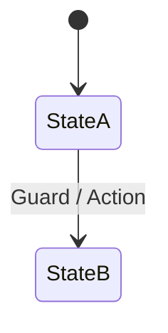
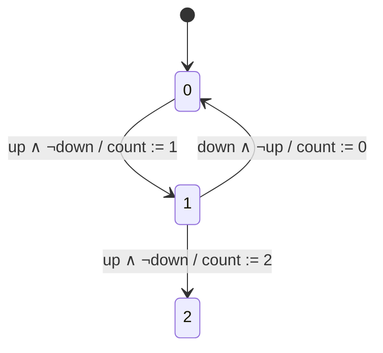
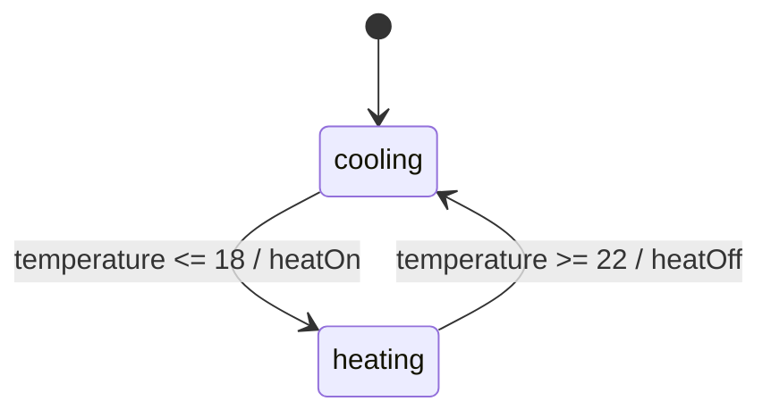
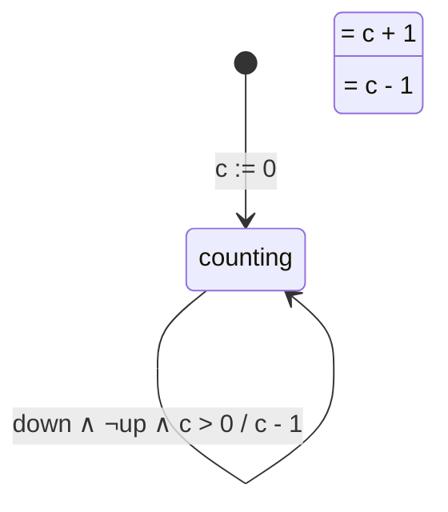
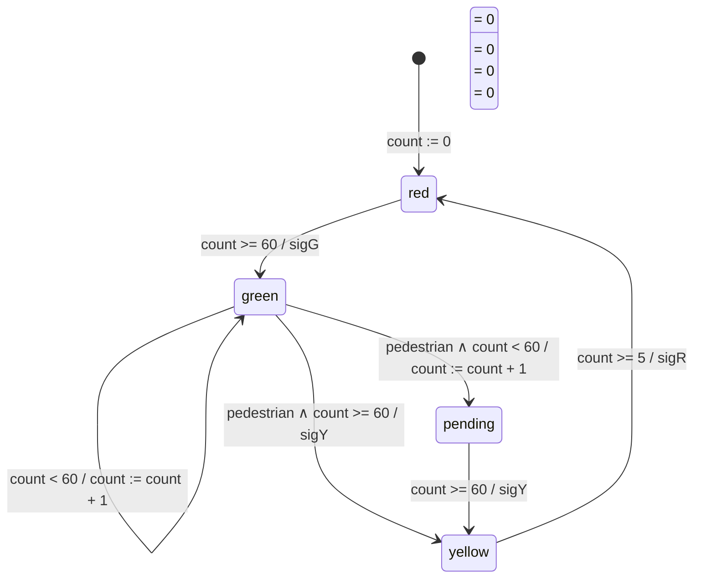

# 📚 جزوه جامع و مفهومی فصل ۳: دینامیک گسسته و ماشین‌های حالت (Discrete Dynamics & State Machines)
> **مرجع اصلی:** کتاب *Introduction to Embedded Systems: A Cyber-Physical Systems Approach* (نویسندگان: Lee & Seshia)  
> **مباحث پوشش داده‌شده:** بخش‌های ۳.۱ تا ۳.۶ (مطابق با تدریس جلسات اول و دوم)

---

## 📌 مقدمه و اهداف آموزشی
در سیستم‌های نهفته و سایبر-فیزیکی (CPS)، نرم‌افزار باید با دنیای فیزیکی در تعامل باشد. برخلاف سیستم‌های فیزیکی محض که رفتار آن‌ها پیوسته است و با معادلات دیفرانسیل مدلسازی می‌شوند، اجزای رایانه‌ای و نرم‌افزاری به‌صورت **گسسته (Discrete)** عمل می‌کنند.

هدف این فصل، یادگیری مدلسازی دقیق و ریاضی رفتار گسسته نرم‌افزار با استفاده از **ماشین‌های حالت (State Machines)** است تا از صحت، پیش‌بینی‌پذیری و ایمنی سیستم مطمئن شویم.

---

# 1️⃣ بخش اول: سیستم‌های گسسته و سیگنال‌ها (Discrete Systems & Signals)

### ۱.۱. سیستم پیوسته در برابر سیستم گسسته
* **سیستم پیوسته (Continuous System):** سیگنال‌ها همواره با زمان به‌صورت پیوسته تغییر می‌کنند ($x(t) \in \mathbb{R}$). مانند سرعت خودرو، دما یا ولتاژ آنالوگ.
* **سیستم گسسته (Discrete System):** سیستم در گام‌ها یا لحظات گسسته‌ای از زمان واکنش نشان می‌دهد. به هر گام محاسباتی یا عملیاتی سیستم در پاسخ به یک رویداد ورودی، یک **واکنش (Reaction)** می‌گویند.

### ۱.۲. سیگنال‌های محض و مقداری (Pure vs. Valued Signals)
در سیستم‌های گسسته، پورت‌های ورودی و خروجی سیگنال دریافت یا ارسال می‌کنند:
1. **سیگنال محض (Pure Signal):** فاقد مقدار عددی است؛ تنها **حضور (present)** یا **عدم حضور (absent)** آن اهمیت دارد.
   * *رابطه ریاضی:* $u : \mathbb{R} 	o \{	ext{present}, 	ext{absent}\}$
   * *مثال:* فشردن دکمه استارت، کلید زنگ، یا دکمه عابر پیاده (`pedestrian`).
2. **سیگنال مقداری (Valued Signal):** علاوه بر حضور، یک مقدار از یک مجموعه داده ($V_p$) را هم حمل می‌کند.
   * *رابطه ریاضی:* $v : \mathbb{R} 	o \{	ext{absent}\} \cup V_p$
   * *مثال:* سنسور دما با مقدار $25^\circ C$، سنسور سرعت، یا شمارنده ماشین‌های پارکینگ (`count`).

---

# 2️⃣ بخش دوم: مفهوم حالت (The Notion of State)

### ۲.۱. تعریف رسمی حالت (State)
**حالت (State)** یک سیستم، انباشت و خلاصه‌ای از تمام اتفاقات گذشته است که بر واکنش سیستم به ورودی‌های زمان حال و آینده تأثیر می‌گذارد:
$$	ext{State = A summary of the past history}$$

* **مثال ملموس:** چراغ‌قوه ساده دو حالت دارد: `[OFF]` و `[ON]`. اگر دکمه را فشار دهید، اینکه چراغ روشن شود یا خاموش، به **حالت فعلی** آن بستگی دارد.

### ۲.۲. فضای حالت (State Space)
به مجموعه تمام حالت‌های ممکنی که یک سیستم می‌تواند در آن قرار گیرد، **فضای حالت** می‌گویند.
* اگر فضای حالت متناهی و قابل شمارش باشد $\implies$ **ماشین حالت متناهی (Finite-State Machine - FSM)**.

---

# 3️⃣ بخش سوم: ماشین‌های حالت متناهی (Finite-State Machines - FSM)

یک FSM مدلی است که در هر واکنش (Reaction)، ارزیابی ورودی‌ها را به ارزیابی خروجی‌ها نگاشت می‌دهد و ممکن است حالت سیستم را تغییر دهد.

### ۳.۱. آناتومی ترانزیشن (Transition)
ترانزیشن فلشی است که از یک حالت به حالت دیگر (یا همان حالت در Self-loop) می‌رود و به‌صورت زیر علامت‌گذاری می‌شود:
$$	ext{Guard} \; / \; 	ext{Action}$$

1. **شرط نگهبان (Guard):** یک عبارت منطقی (Boolean) روی ورودی‌هاست. ترانزیشن زمانی **فعال (enabled)** می‌شود که Guard برابر `true` باشد.
2. **دستور/اکشن (Action):** مقداردهی به پورت‌های خروجی در لحظه عبور از ترانزیشن. پورت‌هایی که نامی از آن‌ها برده نشود، به صورت ضمنی `absent` خواهند بود.



---

### ۳.۲. مثال کاربردی ۱: شمارنده پارکینگ (Garage Counter)
* **ورودی‌ها:** $up, down : 	ext{pure}$ (سنسورهای ورود و خروج)
* **خروجی:** $count : \{0, 1, \dots, M\}$
* **حالت‌ها:** $States = \{0, 1, 2, \dots, M\}$


* **نکته مهم امتحانی:** چرا گارد رفتن از ۰ به ۱ برابر `up ∧ ¬down` است و نه فقط `up`؟  
  * **پاسخ:** زیرا اگر همزمان یک ماشین وارد و یکی خارج شود ($up = 	ext{present}$ و $down = 	ext{present}$)، گارد `up ∧ ¬down` برابر `false` شده و سیستم به نادرستی تعداد را افزایش نمی‌دهد.

---

### ۳.۳. پدیده پسماند (Hysteresis) برای جلوگیری از Chattering
اگر یک ترموستات تنظیم شده روی $20^\circ C$ به صورت ساده عمل کند (زیر ۲۰ روشن، بالای ۲۰ خاموش)، با نوسانات جزئی دما موتور آن به شدت نوسان کرده و می‌سوزد (**Chattering**).

برای حل این مشکل از **پسماند (Hysteresis)** استفاده می‌کنیم که یک بازه اطمینان ایجاد می‌کند:
* **حالت‌ها:** $States = \{	ext{heating}, 	ext{cooling}\}$
* **گارد رفتن به heating:** $	ext{temperature} \le 18 / 	ext{heatOn}$
* **گارد رفتن به cooling:** $	ext{temperature} \ge 22 / 	ext{heatOff}$



---

### ۳.۴. تعریف رسمی ۵-تایی FSM (5-Tuple Formal Model)
از نظر ریاضی، یک FSM با یک ۵-تایی تعریف می‌شود:
$$	ext{FSM} = (States, Inputs, Outputs, update, initialState)$$

1. $States$: مجموعه متناهی حالت‌ها.
2. $Inputs$: مجموعه ارزیابی‌های ورودی ($P 	o V_p \cup \{	ext{absent}\}$).
3. $Outputs$: مجموعه ارزیابی‌های خروجی ($Q 	o V_q \cup \{	ext{absent}\}$).
4. $initialState$: حالت اولیه سیستم.
5. $update$: تابع بروزرسانی که حالت جاری و ورودی جاری را به حالت بعدی و خروجی نگاشت می‌دهد:
   $$update : States 	imes Inputs 	o States 	imes Outputs$$
   $$(s(n+1), y(n)) = update(s(n), x(n))$$

---

### ۳.۵. قطعی بودن (Determinacy) و پذیرندگی (Receptiveness)
* **قطعی بودن (Determinism):** یک FSM قطعی است اگر برای هر حالت و هر ورودی، **حداکثر یک ترانزیشن** فعال وجود داشته باشد (عدم هم‌پوشانی گاردها).
* **پذیرندگی (Receptiveness):** سیستم برای هر ورودی ممکن، **حداقل یک ترانزیشن** داشته باشد و قفل نکند.
* **واکنش درجا زدن (Stuttering Reaction):** اگر هیچ گاردی برقرار نشود یا هیچ ورودی نیاید، سیستم بدون تغییر حالت و با خروجی `absent` در حالت خود **درجا می‌زند (Stuttering)**.

---

### ۳.۶. ماشین میلی (Mealy) در برابر ماشین مور (Moore)
| ویژگی | ماشین میلی (Mealy Machine) | ماشین مور (Moore Machine) |
| :--- | :--- | :--- |
| **محل خروجی** | روی **ترانزیشن‌ها (فلش‌ها)** نوشته می‌شود | درون **حباب حالت** نوشته می‌شود |
| **وابستگی خروجی** | تابع همزمان حالت جاری و ورودی جاری ($Output = f(s, x)$) | فقط تابع حالت جاری ($Output = f(s)$) |
| **سرعت پاسخ** | خروجی بلافاصله با تغییر ورودی صادر می‌شود | خروجی با یک گام تاخیر پس از ورود به حالت جدید صادر می‌شود |

---

# 4️⃣ بخش چهارم: ماشین‌های حالت توسعه‌یافته (Extended State Machines)

### ۴.۱. مسئله انباشت و انفجار حالت‌ها (State Explosion)
اگر تعداد حالت‌ها بزرگ شود (مثلا شمارنده تا ۶۰ ثانیه یا ۱۰۰۰ خودرو)، رسم گراف حباب‌ها غیرممکن می‌شود.  
**حل مسئله:** اضافه کردن **متغیرهای حافظه (State Variables)** به FSM.

### ۴.۲. فرمت نگارش EFSM
در ماشین حالت توسعه‌یافته، مشخصات فلش به‌صورت زیر ارتقا می‌یابد:
$$	ext{Guard} \; / \; 	ext{Output Action} \quad 	ext{Set Action}$$

* **Set Action (دستورات بروزرسانی):** مقادیری که به متغیرهای داخلی اختصاص می‌یابند ($c := c + 1$). این دستورات **بعد از ارزیابی Guard و تولید Output** اجرا می‌شوند.



---

### ۴.۳. مدل‌سازی زمان و تایمرها (Timers & Time-Triggered EFSM)
در سیستم‌های بی‌درنگ، زمان با سیگنال‌های دوره‌ای `tick` (مثلاً ۱ ثانیه‌ای) و متغیرهای شمارنده ($count$) مدلسازی می‌شود.

**مثال: چراغ راهنمای عابر پیاده (Pedestrian Traffic Light):**
* **حالت‌ها:** `red`, `green`, `pending`, `yellow`
* **متغیر:** $count \in \{0, \dots, 60\}$
* **رفتار زمانی:** ۶۰ ثانیه سبز، در صورت حضور عابر ۵ ثانیه زرد، سپس ۶۰ ثانیه قرمز.



### ۴.۴. محاسبه تعداد حالت‌های قابل دسترس (Reachable States)
اگر $n$ تعداد حباب‌ها، $m$ تعداد متغیرها و $p$ تعداد مقادیر ممکن برای هر متغیر باشد:
$$	ext{Total States} = n 	imes p^m$$

* **مثال امتحانی:** در چراغ راهنمای بالا ($n=4$ حالت و $count \in \{0, \dots, 60\}$):
  * **کل حالت‌های ممکن:** $4 	imes 61 = 244$
  * **حالت‌های قابل دسترس (Reachable States):** در حالت `yellow` متغیر $count$ فقط مقادیر $0$ تا $5$ (۶ مقدار) را می‌گیرد:
    $$	ext{Reachable States} = (3 	imes 61) + (1 	imes 6) = 183 + 6 = 189$$

---

# 5️⃣ بخش پنجم: پیاده‌سازی کد C در سیستم‌های بی‌درنگ

در نرم‌افزارهای نهفته، یک EFSM مستقیماً به یک ساختار `switch-case` و حلقه رویداد (Event Loop) ترجمه می‌شود.

```c
#include <stdio.h>
#include <stdbool.h>

// 1. تعریف حالت‌های سیستم
typedef enum {
    STATE_IDLE,
    STATE_COOKING,
    STATE_PAUSED
} State_t;

// 2. ساختار متغیرهای EFSM
typedef struct {
    State_t currentState;
    int timerCount;
    bool doorOpen;
    bool startPressed;
} Microwave_t;

// 3. تابع بروزرسانی و حلقه اصلی (Reaction Step)
void Microwave_Update(Microwave_t *dev) {
    switch (dev->currentState) {
        case STATE_IDLE:
            if (dev->startPressed && !dev->doorOpen) {
                dev->currentState = STATE_COOKING;
                printf("Magnetron: ON, Light: ON\n");
            }
            break;

        case STATE_COOKING:
            if (dev->doorOpen) {
                dev->currentState = STATE_PAUSED;
                printf("Magnetron: OFF (Safety Interlock)\n");
            } else if (dev->timerCount <= 0) {
                dev->currentState = STATE_IDLE;
                printf("Cooking Finished! Light: OFF\n");
            } else {
                dev->timerCount--; // Set Action: کاهش تایمر
            }
            break;

        case STATE_PAUSED:
            if (dev->startPressed && !dev->doorOpen) {
                dev->currentState = STATE_COOKING;
                printf("Resuming Cooking... Magnetron: ON\n");
            }
            break;
    }
}
```

---

# 6️⃣ بخش ششم: نمونه سوالات امتحانی به همراه پاسخ تشریحی

### 📝 سوال ۱ (تعاریف پایه):
**چرا در یک سیستم بی‌درنگ، قطعی بودن (Determinism) یک الزام ایمنی است؟**
* **پاسخ:** زیرا در سیستم‌های غیرقطعی، برای یک ورودی یکسان ممکن است دو رفتار متفاوت رخ دهد. در کاربردهای حساس به ایمنی (مثل ترمز ABS یا کنترل پرواز)، عدم قطعیت می‌تواند منجر به فاجعه شود.

---

### 📝 سوال ۲ (محاسبات فضای حالت):
**یک ماشین حالت توسعه‌یافته دارای ۳ حباب حالت و دو متغیر صحیح $x \in \{0..10\}$ و $y \in \{0..5\}$ است. کل فضای حالت این سیستم چقدر است؟**
* **پاسخ:**
  * مقادیر $x$: ۱۱ مقدار
  * مقادیر $y$: ۶ مقدار
  * کل حالت‌ها = $3 	imes 11 	imes 6 = 198$ حالت.

---

### 📝 سوال ۳ (تحلیل گاردها):
**در ماشین حالت زیر، آیا سیستم قطعی (Deterministic) است؟ چرا؟**
* ترانزیشن ۱ از حالت $A$ به $B$ با گارد $temp > 20$
* ترانزیشن ۲ از حالت $A$ به $C$ با گارد $temp < 25$
* **پاسخ:** خیر، سیستم **غیرقطعی (Nondeterministic)** است؛ زیرا در دماهای بین ۲۰ تا ۲۵ (مثلا $temp = 22$)، هر دو گارد همزمان `true` می‌شوند و سیستم نمی‌داند به $B$ برود یا $C$.

---

## 🏁 جمع‌بندی ترمینولوژی کلیدی
* **Reaction:** گام محاسباتی آنی سیستم گسسته.
* **State:** خلاصه‌ای از تاریخچه گذشته سیستم.
* **Guard:** شرط منطقی روی ترانزیشن.
* **Action:** خروجی صادر شده یا مقدار تغییر یافته در ترانزیشن.
* **Hysteresis:** رفتار وابسته به مسیر برای جلوگیری از Chattering.
* **Stuttering:** درجا زدن سیستم در غیاب ورودی بدون تغییر حالت.
* **EFSM:** ارتقای FSM با متغیرهای داخلی جهت جلوگیری از انفجار حالت‌ها.
